<picture><source media="(prefers-color-scheme: dark)" srcset="assets/hero-dark.svg"></picture>

<picture><source media="(prefers-color-scheme: dark)" srcset="assets/about-dark.svg"></picture>

<picture><source media="(prefers-color-scheme: dark)" srcset="assets/stack-dark.svg"></picture>

<a href="https://github.com/winncoder/shell-chooser-gui"><picture><source media="(prefers-color-scheme: dark)" srcset="assets/project-shell-chooser-gui-dark.svg"></picture></a>&nbsp;<a href="https://github.com/winncoder/My-font-Sf-pro-"><picture><source media="(prefers-color-scheme: dark)" srcset="assets/project-my-font-sf-pro-dark.svg"></picture></a>

<a href="https://github.com/winncoder/Cloud-pc-"><picture><source media="(prefers-color-scheme: dark)" srcset="assets/project-cloud-pc-dark.svg"></picture></a>&nbsp;<a href="https://github.com/winncoder/Test-Cloud-Pc"><picture><source media="(prefers-color-scheme: dark)" srcset="assets/project-test-cloud-pc-dark.svg"></picture></a>

<picture><source media="(prefers-color-scheme: dark)" srcset="assets/stats-dark.svg"></picture>

<picture><source media="(prefers-color-scheme: dark)" srcset="assets/streak-dark.svg"></picture>

<picture><source media="(prefers-color-scheme: dark)" srcset="assets/wave-dark.svg"></picture>

<a href="https://github.com/winncoder?tab=repositories"><picture><source media="(prefers-color-scheme: dark)" srcset="assets/button-1-dark.svg"></picture></a>

<a href="https://metawka.github.io/expressive-profile/?from=winncoder"><picture><source media="(prefers-color-scheme: dark)" srcset="assets/credit-dark.svg"></picture></a>

